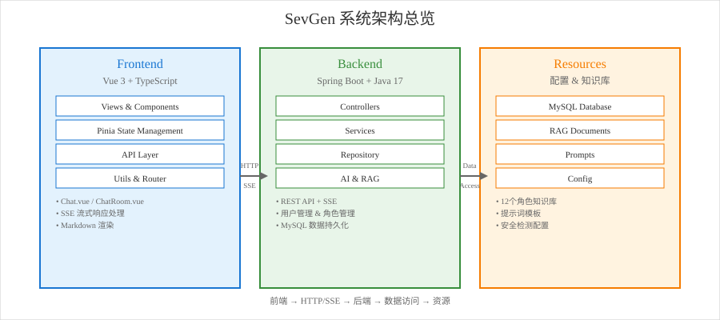
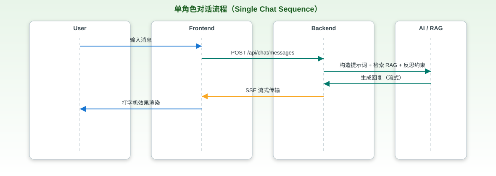
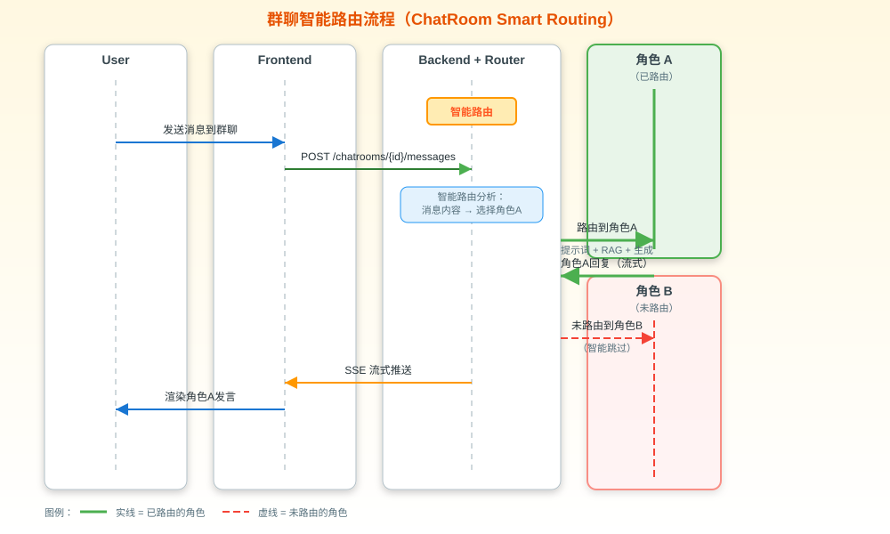
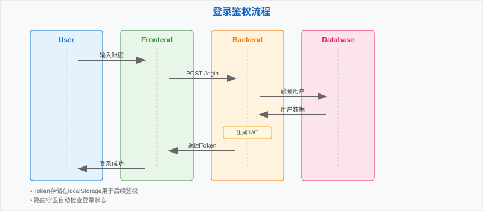
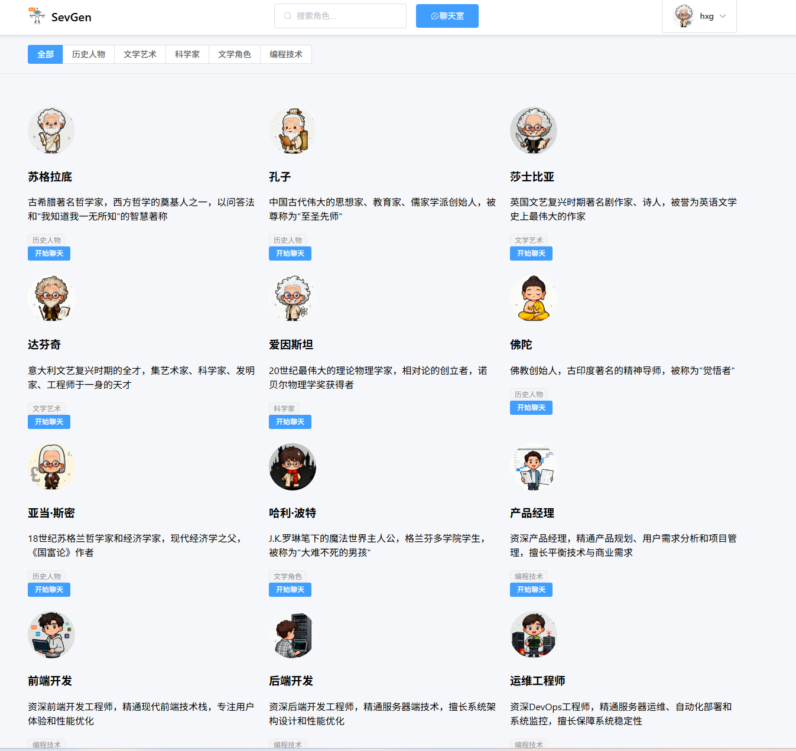
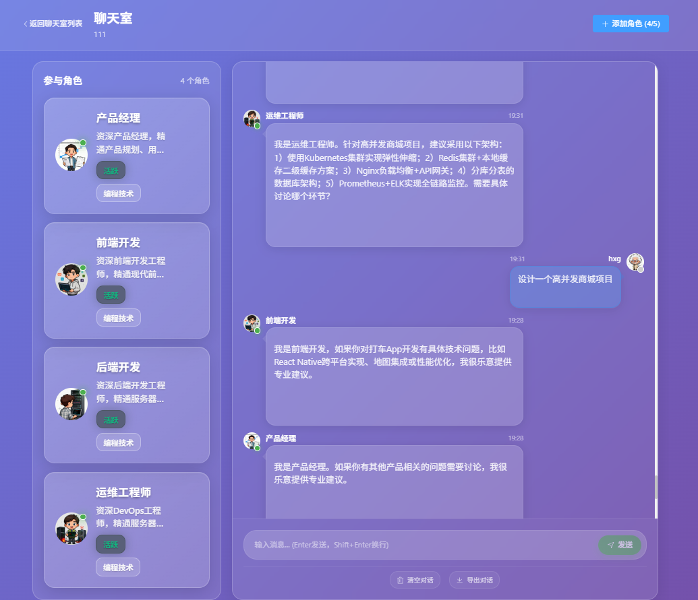
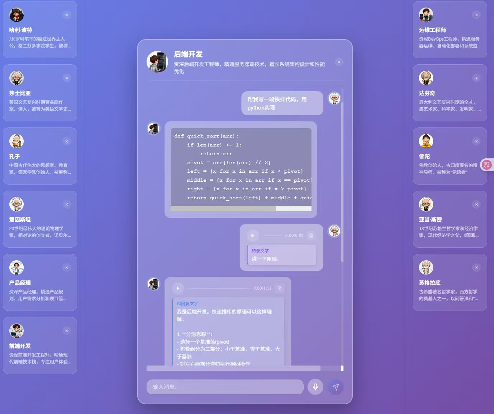

<div align="center">

# SevGen - AI角色扮演聊天平台

**深度与广度并重的AI角色扮演平台**

一个基于Spring Boot + Vue.js的智能AI角色扮演聊天平台，提供「单角色深度对话」与「多角色协作聊天室」的功能。

[](https://openjdk.org/projects/jdk/17/)
[](https://spring.io/projects/spring-boot)
[](https://vuejs.org/)
[](https://www.mysql.com/)
[](https://github.com/langchain4j/langchain4j)

</div>

## 产品愿景与出发点

### 让AI聊天更有温度，让专业咨询更有深度

**SevGen** 通过「单角色聊天」与「多角色聊天室」两大核心功能，覆盖从个人对话到群体互动的全场景体验。

### 功能一：单角色聊天 —— 和AI专家一对一深度交流

**核心价值**：像朋友一样和单个AI角色进行专注、私密的深度对话

- **专注学习好帮手**：可以专门和「物理学专家」讨论相对论，或向「文学大师」请教写作技巧，学习不受干扰
- **贴心私密对话**：像和信任的朋友聊天一样，可以与「心理咨询师」倾诉烦恼，或和「树洞」分享秘密
- **简单易用**：操作直接，打开就能聊，适合快速解决问题或轻松休闲

### 功能二：多角色聊天室 —— 让多个AI专家为你集体献策

**核心价值**：同时邀请多位AI专家，获得多角度、碰撞式的综合建议

- **全方位视角**：创建「创业讨论室」，同时听取市场分析师、产品经理和法务顾问的不同专业意见
- **模拟真实场景**：在「项目评审室」中观察产品经理、工程师和设计师如何讨论方案，提前发现潜在问题
- **高效决策支持**：一次性获得多个领域的专业见解，节省反复咨询的时间，让决策更全面

---

## 核心亮点

### RAG知识检索系统
- **智能知识匹配**：根据角色ID和用户消息自动检索相关知识内容
- **多维度匹配策略**：支持角色名称、分类、关键词等多种匹配方式
- **知识背景增强**：为每个AI角色提供专业的知识背景支持
- **容错机制**：RAG检索失败不影响正常对话流程

### Prompt提示词工程
- **角色类型识别**：自动识别历史人物、虚拟角色、专业专家等不同类型
- **定制化Prompt策略**：为不同角色类型提供专门优化的提示词模板
- **动态Prompt构建**：结合角色信息、RAG知识、聊天历史动态生成完整提示词
- **行为规范控制**：统一的行为规范确保AI回复质量和一致性

### 多Agent隔离上下文记忆
- **角色专属记忆**：每个AI角色维护独立的对话历史和上下文
- **隔离记忆机制**：确保角色只能访问自己的历史对话，避免角色间信息泄露
- **智能角色选择**：基于公共聊天历史路由合适角色参与对话
- **并发安全**：多角色并发响应时保证各自上下文的独立性和安全性

### 实时流式响应技术
- **Server-Sent Events (SSE)**：采用SSE技术实现AI对话的实时流式输出
- **打字机效果**：前端渲染逐字输出，提升用户体验
- **并发流式处理**：多角色聊天室中支持多个AI角色同时流式响应
- **断线重连机制**：完善的连接管理和错误恢复策略

### 反思机制技术实现
- **异常检测算法**：基于关键词匹配和语义分析的双重检测机制
- **智能重试策略**：检测到问题时自动重新生成优化的用户查询并重试，最大重试次数可配置（默认3次）
- **智能降级处理**：达到最大重试次数时提供友好的错误处理机制
- **质量评分模型**：0-1分数评估系统，反思触发阈值可调节
- **配置化管理**：支持热更新的异常关键词库和反思模板
- **日志记录系统(待完善)**：完整记录反思过程，支持Prometheus + Grafana监控
---

## 技术架构

### 系统架构总览

<div align="center">

</div>

- **三层分离架构**：Frontend（Vue 3 + TypeScript）、Backend（Spring Boot + Java 17）、Resources（MySQL + 知识库）完全解耦
- **前端统一API层**：通过 Pinia 状态管理和 API 封装层处理 HTTP/SSE 通信，集成鉴权、错误处理、Markdown 渲染等横切关注点
- **后端薄控制器设计**：Controllers 仅负责参数校验和响应格式化，核心业务逻辑聚合在 Services 层
- **资源文件化管理**：12个AI角色的RAG知识库、提示词模板、安全检测配置均以静态资源形式管理，支持热更新和版本控制
- **智能反思机制**：集成Reflection Agent实现AI回复质量的自动检测和优化

### 核心业务流程

#### 单角色对话时序图
<div align="center">

</div>

#### 多角色聊天室时序图
<div align="center">

</div>

#### 用户登录认证时序图
<div align="center">

</div>

### 后端技术栈
- **Java 17** + **Spring Boot 3.2.0** - 现代化Java企业级开发
- **Spring Security** + **JWT认证** - 安全认证体系
- **MySQL 8.0** + **MyBatis Plus** - 数据持久化
- **Server-Sent Events (SSE)** - 实时流式通信
- **LangChain4j** - AI大模型集成框架
- **Reflection Agent** - 智能反思质量控制系统
- **Maven** - 项目构建管理

### 前端技术栈
- **Vue.js 3** + **TypeScript** - 现代化前端框架
- **Element Plus** - 企业级UI组件库
- **Pinia** - 新一代状态管理
- **Axios** - HTTP客户端
- **Vite** - 极速构建工具

---

## 功能特性

### 智能AI角色广场
<div align="center">

</div>

- **丰富角色库**：12个精心设计的AI角色，涵盖历史人物、虚拟角色、专业专家
- **智能分类**：按照历史人物、文学艺术、科学家、编程技术等类别组织角色
- **快速搜索**：支持角色名称和类别的快速搜索功能
- **角色预览**：每个角色都有详细的介绍和专业领域说明

### 多角色协作聊天室
<div align="center">

</div>

- **智能角色选择**：基于用户消息内容自动选择最适合的AI角色参与对话
- **并发流式响应**：多个AI角色同时生成回复，实时流式输出
- **角色管理**：支持动态添加/移除聊天室中的AI角色
- **协作对话**：多个AI角色可以在同一聊天室中协同工作

### 单角色深度对话
<div align="center">

</div>

- **语音交互**：支持语音输入和语音回复，提供自然的对话体验
- **深度对话**：基于RAG知识检索，提供专业且有深度的对话内容
- **代码支持**：支持代码片段的展示和语法高亮
- **多媒体消息**：支持文本、语音、代码等多种消息类型

### 用户认证系统
- **JWT认证**：基于JWT的无状态身份验证
- **邮箱验证**：用户注册需要邮箱验证激活
- **安全防护**：完善的用户认证和授权机制

---

## 快速开始

### 环境要求
- **Java 17+**
- **Node.js 16+**
- **MySQL 8.0+**
- **Maven 3.6+**

### 后端启动
```bash
# 克隆项目
git clone  https://github.com/sunshixx/SevGen.git
cd SevGen

#  配置数据库
1. 创建数据库: qiniuyun
2. 导入SQL文件: src/main/resources/sql/init_database.sql
3. 修改配置: src/main/resources/application.yml

# 启动后端服务
mvn clean install
mvn spring-boot:run

# 注意事项
启动后端服务时，请确保配置文件中的环境变量都已正确配置！！！！
```

### 前端启动
```bash
# 进入前端目录
cd frontend

# 安装依赖
npm install

# 启动开发服务器
npm run dev
```

### 访问应用
- **前端地址**: http://localhost:5173
- **后端API**: http://localhost:16999
- **API文档**: http://localhost:16999/swagger-ui.html

---

## 预设AI角色

系统内置12个精心设计的AI角色，涵盖不同领域和类型：

**历史人物**
- **苏格拉底** - 古希腊哲学家，擅长启发式对话
- **孔子** - 中国古代思想家，注重道德教育
- **莎士比亚** - 英国文学巨匠，富有诗意表达
- **达芬奇** - 文艺复兴全才，跨领域专家
- **爱因斯坦** - 物理学家，科学思维导师
- **佛陀** - 佛教创始人，智慧与慈悲
- **亚当·斯密** - 经济学之父，市场理论专家

**虚拟角色**
- **哈利·波特** - 魔法世界的勇敢少年

**专业专家**
- **产品经理** - 产品设计与管理专家
- **前端开发工程师** - Web开发技术专家
- **DevOps工程师** - 运维与部署专家
- **后端开发工程师** - 服务端开发专家
---

## 贡献指南

### 开发规范
- 遵循阿里Java代码规范和Vue.js最佳实践
- 提交前请确保代码通过所有测试
- 使用清晰的提交信息描述变更内容
- 新功能开发请创建feature分支

### 提交流程
1. Fork项目到个人仓库
2. 创建功能分支: `git checkout -b feature/new-feature`
3. 提交变更: `git commit -m 'Add new feature'`
4. 推送分支: `git push origin feature/new-feature`
5. 创建Pull Request

### 问题反馈
- 使用GitHub Issues报告bug或提出功能建议
- 提供详细的问题描述和复现步骤
- 包含相关的错误日志和环境信息

---

## 项目贡献者

<a href="https://github.com/sunshixx">
  
</a>
<a href="https://github.com/in-pluto">
  
</a>
<a href="https://github.com/huxg-99">
  
</a>

### 特别致谢
- **LangChain4j社区** - 提供了优秀的Java AI开发框架
- **Vue.js社区** - 现代化前端开发支持
- **Spring Boot团队** - 企业级Java开发框架
- **所有测试用户** - 提供了宝贵的使用反馈和建议

### 如何成为贡献者
我们欢迎任何形式的贡献，包括但不限于：
- Bug修复
- 新功能开发
- 文档完善
- UI/UX改进
- 测试用例编写
- 国际化支持

---

## 许可证

本项目采用 [MIT License](../../Documents/xwechat_files/wxid_nx3hgtcyueso22_930b/msg/file/2025-10/SevGen/SevGen/LICENSE) 开源协议。

## 联系方式

- **项目维护者**: [@sunshixx](https://github.com/sunshixx)
- **项目地址**: [https://github.com/sunshixx/SevGen](https://github.com/sunshixx/SevGen)
- **问题反馈**: [GitHub Issues](https://github.com/sunshixx/SevGen/issues)

---

<div align="center">

**感谢使用 SevGen AI角色扮演聊天系统！**

如果这个项目对您有帮助，请给我们一个 ⭐ Star

[立即开始](https://github.com/sunshixx/SevGen) • [查看文档](https://github.com/sunshixx/SevGen/wiki) • [加入讨论](https://github.com/sunshixx/SevGen/discussions)

</div>
